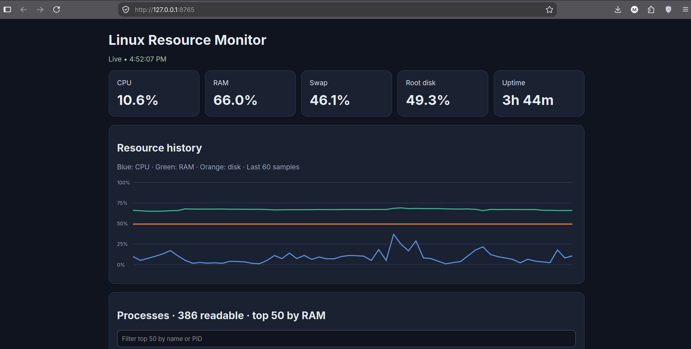
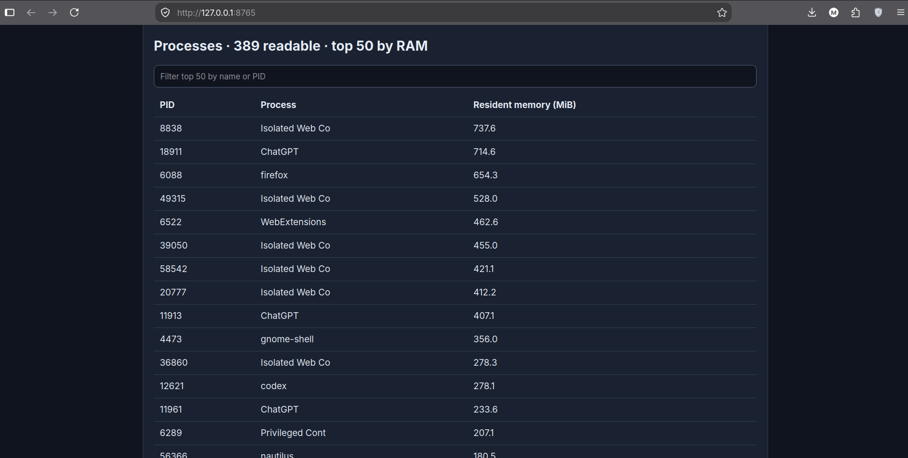
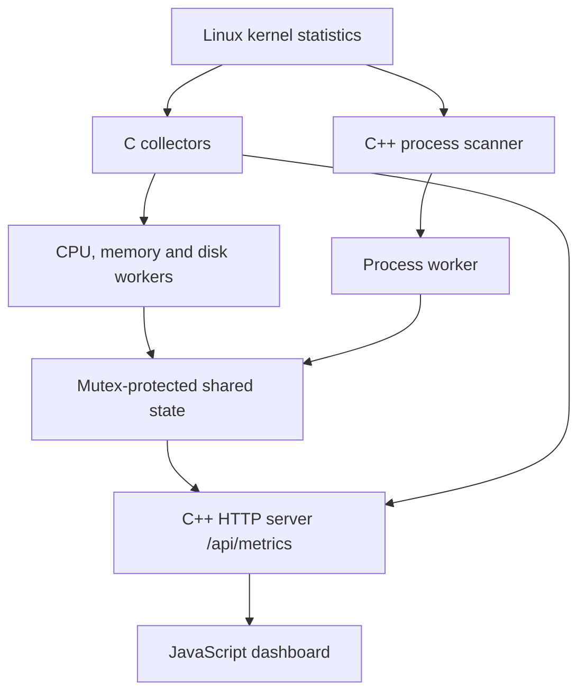

# Linux System Resource Monitor

A lightweight, browser-based system monitor for Linux, built using C, C++17, STL, multithreading, POSIX sockets and vanilla JavaScript. It collects live system statistics directly from Linux and presents them in a responsive dark-themed dashboard without external libraries.

## Screenshots

### Live resource dashboard



### Process monitor



## Features

- Live CPU, RAM, swap and root filesystem usage
- System uptime and resource history (last 60 successful samples)
- Top 50 readable processes ranked by resident memory, with PID/name filtering
- Four independent monitoring threads and mutex-protected shared state
- Local HTTP server and JSON API; no external dependencies or root privileges required

## Technology stack

| Technology | Role |
| --- | --- |
| C | CPU counters, memory, disk and uptime collectors |
| C++17 | Backend, process scanning and HTTP server |
| STL | Vectors, strings, sorting and filesystem traversal |
| Multithreading | Four worker threads using `std::thread` and `std::mutex` |
| Linux/UNIX | `/proc` filesystem, `statvfs` and POSIX sockets |
| HTML, CSS, JavaScript | Dashboard, polling, charts and process filtering |
| Make | Compilation and build automation |

## Architecture



CPU utilization is calculated from the difference between consecutive CPU counter samples. RAM usage uses `MemTotal` and `MemAvailable`. Disk capacity is obtained using `statvfs`. Process information is read from `/proc/<pid>/status` and sorted by resident memory. The browser polls the JSON API and updates the dashboard.

## Getting started

### Prerequisites

- Linux (Ubuntu or another compatible distribution)
- GCC, G++ with C++17 support, Make and a modern browser

On Ubuntu/Debian, install the build tools:

```bash
sudo apt update
sudo apt install build-essential
```

### Build and run

Open a terminal in the extracted or cloned project directory:

```bash
make
./monitor
```

Open **http://127.0.0.1:8765** in your browser. Press `Ctrl+C` in the terminal to stop the server.

To remove compiled files:

```bash
make clean
```

| Command | Purpose |
| --- | --- |
| `sudo apt update` | Refresh package information |
| `sudo apt install build-essential` | Install compilers and Make |
| `make` | Compile C and C++ source and link the executable |
| `./monitor` | Start the local monitoring server |
| `make clean` | Remove generated build files |

## Project structure

```text
LinuxMonitor/
├── main.cpp                 # C++ backend and worker threads
├── metrics.c                # C system metric collectors
├── metrics.h                # C/C++ interface
├── Makefile                 # Build rules
├── web/
│   └── index.html           # HTML, CSS and JavaScript dashboard
├── screenshots/
│   ├── dashboard.png
│   └── processes.png
├── .gitignore
└── README.md
```

## API

| Endpoint | Description |
| --- | --- |
| `GET /` | Serves the dashboard |
| `GET /api/metrics` | Returns CPU, RAM, swap, disk, uptime and process data as JSON |

Test the API while the server is running (requires curl):

```bash
curl http://127.0.0.1:8765/api/metrics
```

## Limitations

- Designed for local educational use; the server binds to localhost and is not intended for public deployment.
- Read-only monitoring; no process termination or persistent history.
- Disk usage measures root filesystem capacity, not disk I/O.
- Process memory may include shared pages counted in multiple processes. Only the top 50 readable processes are shown.
- CPU usage is unavailable until two samples have been collected. Systems without swap show 0% swap usage.
- Container environments may expose host or namespace-specific statistics.

## Learning outcomes

Linux system programming, C/C++ interoperability, STL containers and algorithms, concurrent programming, synchronization, socket programming, HTTP/JSON communication and browser-based visualization.
